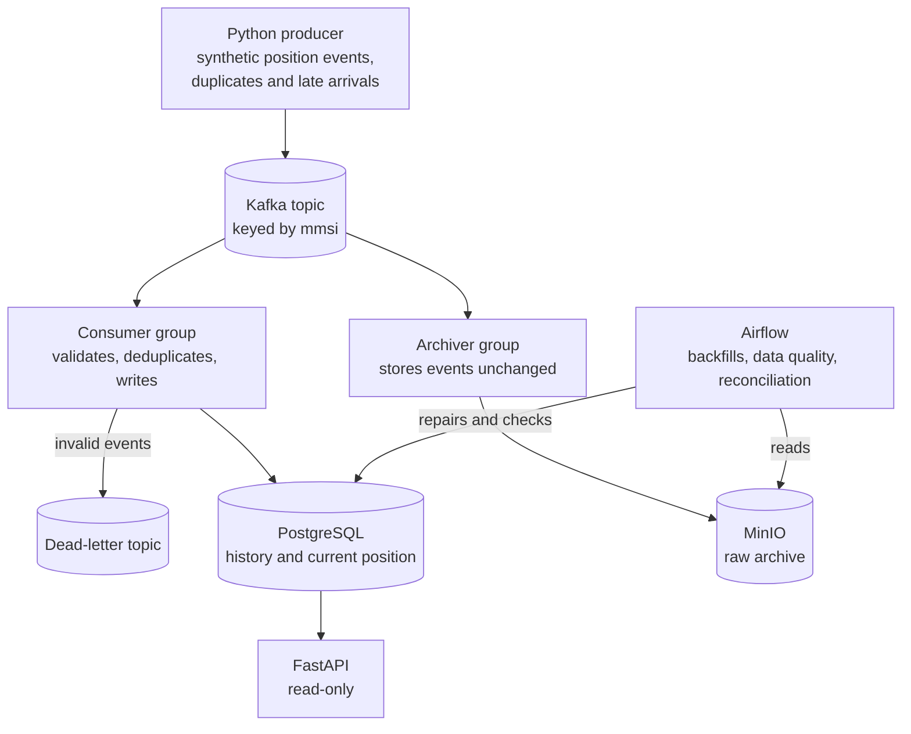

# Architecture

## Data flow

| Component | Status |
|---|---|
| PostgreSQL, schema, roles | Built |
| CI gates | Built, with `sit` and `uat` as placeholders |
| Kafka, producer | Planned |
| Consumer, dead-letter topic, MinIO, archiver | Planned |
| FastAPI | Planned |
| Airflow | Planned |

## How an event is written

1. The producer publishes an event keyed by `mmsi`, so all events for one vessel stay in order within a partition.
2. The consumer validates it. Events that can never be valid go to the dead-letter topic.
3. In one database transaction, the consumer inserts into `vessel_events` and upserts `vessel_positions_current`.
4. Only after that transaction commits does the consumer commit its Kafka offset.
5. Separately, the archiver reads the same topic and stores every event unchanged, including invalid ones.

## Guarantees

| Situation | Result |
|---|---|
| Same event delivered twice | The primary key `(mmsi, event_time)` keeps one history row |
| Event arrives late | It enters history, and the upsert guard leaves the newer current position in place |
| Consumer crashes after the database commit, before the offset commit | The event is reprocessed and ignored as a duplicate |
| Validation logic had a bug | Airflow reprocesses from the raw archive, which holds every original event |

Delivery is at-least-once. Idempotent writes make the outcome effectively once.

## Delivery environments

Work moves through `feature/*`, `dev`, `sit`, `uat` and `main` by pull request.

| Branch | Gate |
|---|---|
| `dev` | Lint, schema tests, Compose validation, secret scan, promotion-path check |
| `sit` | The above, plus an integration test (placeholder for now) |
| `uat` | The above, plus an acceptance test (placeholder for now) |
| `main` | The above, plus manual approval of the `prod` environment |

No servers sit behind these environments. `sit` and `uat` are temporary Compose stacks on a GitHub runner, and `prod` is a tagged release run locally. In a real deployment each would be a separate cloud account.
